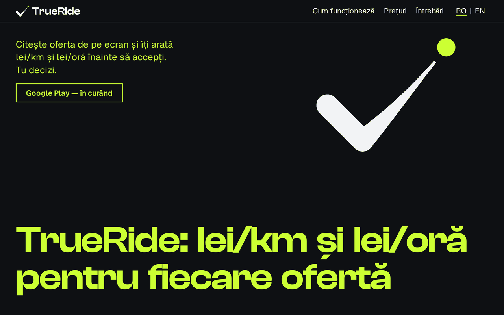
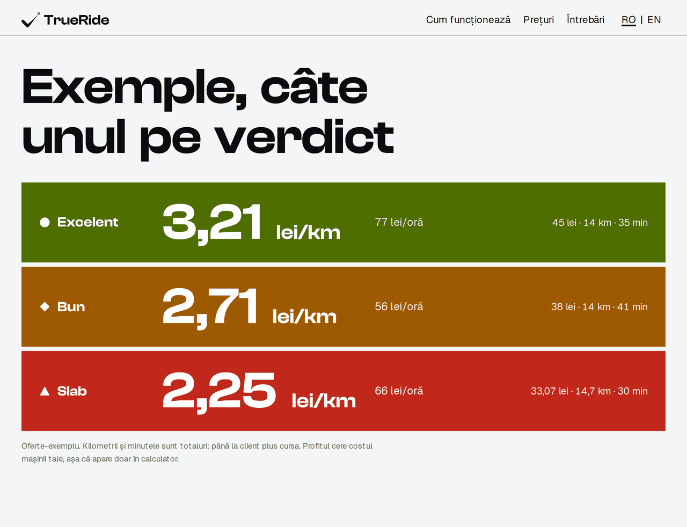
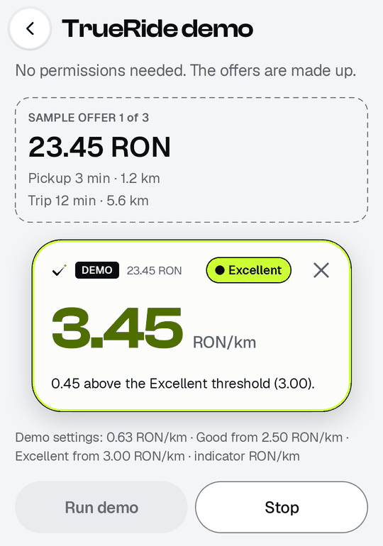
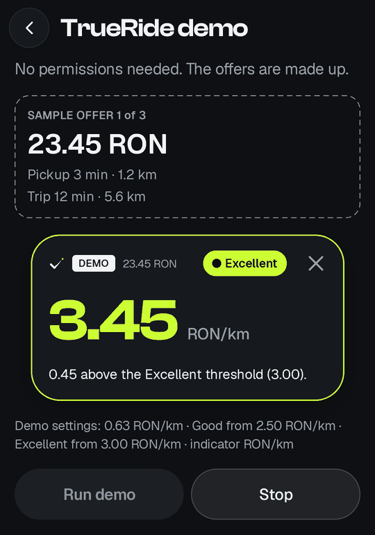
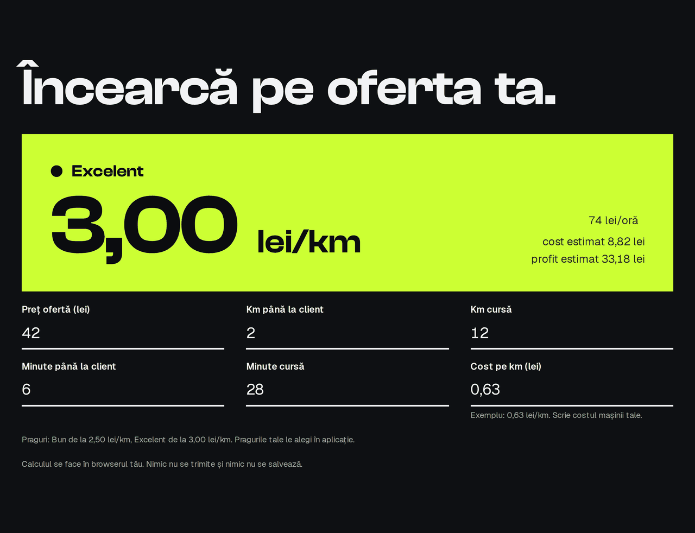

# TrueRide

[](https://github.com/Ro98ert/TrueRide/actions/workflows/ci.yml)

**Asistent Android pentru șoferii de ride-sharing din România: îți arată, înainte să accepți, cât plătește de fapt o cursă.**



## Problema

Un șofer are câteva secunde să accepte sau să refuze o cursă. Prețul se vede, dar cât câștigă de fapt pe kilometru și pe oră, după drumul gol până la client și costul mașinii, nu se vede. Decizia se ia din instinct, iar cursele proaste se acceptă des.

## Cum funcționează

1. **Citește.** Când apare o ofertă, TrueRide citește cifrele de pe ecran: preț, kilometri, minute. Doar cifrele, fără nume sau adrese.
2. **Calculează.** Lei pe kilometru, lei pe oră și profitul estimat, după costul mașinii tale.
3. **Arată.** Un card peste ofertă, în culoarea verdictului: Excelent, Bun sau Slab. Tu decizi.



### În aplicație

Cardul de verdict, în modul demo al aplicației (ofertă inventată, zi și noapte):

| Zi | Noapte |
|---|---|
|  |  |

### Pe site

| Calculatorul de pe site | Pe telefon |
|---|---|
|  |  |

*Toate cifrele din imagini sunt oferte-exemplu, nu curse reale.*

## Promisiuni

- **Doar citește.** TrueRide nu acceptă și nu refuză nicio cursă în locul tău.
- **Imaginea ecranului nu pleacă de pe telefon.** Se folosesc doar cifrele și unitățile; nume și adrese nu se păstrează.
- **Formule publice.** Calculul de bani e în acest repository, cu teste.

## Stadiu

- Aplicația Android rulează și e în testare cu șoferi. **Google Play: în curând.**
- Site-ul de prezentare e în lucru și se publică după finalizare.
- Nucleul de calcul și citire (acest repository) are 653 de teste automate, rulate la fiecare modificare.

## Cine l-a construit

TrueRide e construit de [Robert Amartisoaei](https://github.com/Ro98ert), cu agenți AI (Claude Code) într-un proces disciplinat: planificare, teste, revizii. Metoda e descrisă în [AI_WORKFLOW.md](AI_WORKFLOW.md).

Nu este afiliat cu Uber sau Bolt. Uber și Bolt sunt mărci ale proprietarilor lor.

---

## Pentru dezvoltatori

TrueRide is read-only: it never accepts or declines rides.

### What this repository contains


Only the pure Kotlin/JVM core of the project. The Android app is not included. The four modules below have no Android dependency, so their tests run on a laptop in seconds.

| Module | What it does |
|---|---|
| `core-model` | Data types: parsed offer, offer input, cost, thresholds, evaluation, verdict, units. Depends on the Kotlin standard library only. |
| `core-calc` | Money math with `BigDecimal`: income per hour, per km and per minute, estimated cost and profit, and the verdict against the driver's thresholds. |
| `core-parse` | Turns OCR lines from a ride-offer screen into a parsed offer. It applies rule sets (Uber RO, Uber EN, Bolt RO) and extracts numbers and units only. |
| `core-lant` | The card state machine: which source wins (accessibility nodes or OCR), the card states, and the rule that no number from a previous offer is shown. |

Dependencies: `core-calc` and `core-parse` depend on `core-model`. `core-lant` depends on `core-parse` and `core-calc`.

### Rules the code follows

- No Android on the classpath. The modules are plain Kotlin/JVM, so `import android.*` does not compile.
- Money is `BigDecimal`, never floating point.
- Rounding happens once, at display time. Values in the calculation chain are not rounded.
- Division by zero is a state, not an exception. A zero or missing total time makes the indicator unavailable.
- Missing data is shown as unknown. A field that cannot be read stays `null`, never 0.
- The parser extracts numbers and units only. It does not extract addresses or names.
- A rule set is separate from the parser engine. A layout change in a ride app touches a rule file, not the engine.

### Fixtures

The `fixtures/` directory holds anonymized captures of ride-offer screens. OCR lines are masked. Most captures have a hand-written expected result (`*.asteptat.json`) that the tests compare against. The `uber-en` captures have none, and no published test reads them. Some fixture sets are not published.

### Build and test

The Gradle daemon needs JDK 25 (see `gradle/gradle-daemon-jvm.properties`). The compiled bytecode targets Java 17.

```
./gradlew :core-model:test :core-calc:test :core-parse:test :core-lant:test
```

The `test` tasks are the supported entry point. The `replay` and `explorare` tasks in `core-parse` are developer tools driven by private scripts and are not documented here.

The last full run had 653 tests, 11 of them skipped by design (`CazuriGresiteDezactivateTest`).

### Language

Identifiers and comments are in Romanian. Comments cite decision IDs such as `D-033`. They refer to a private decision log that is not published.

### Built with AI assistance

TrueRide was built with Claude Code. See [AI_WORKFLOW.md](AI_WORKFLOW.md) for the method.

### License

All rights reserved. The source is published for review. There is no permission to use, copy, modify or distribute it beyond what the GitHub Terms of Service grant (viewing and forking on GitHub). See [LICENSE](LICENSE).
